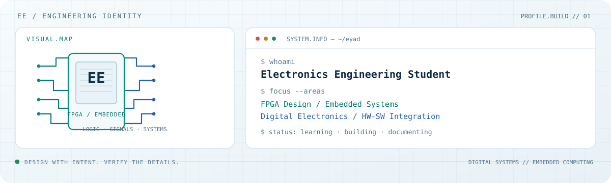

<picture>
  <source media="(prefers-color-scheme: dark)" srcset="dark.svg">
  
</picture>

<div align="center">

### ELECTRONICS ENGINEERING · FPGA · EMBEDDED SYSTEMS

**I turn digital-design concepts into integrated hardware/software prototypes.**

[Projects](#featured-projects) · [Technical Focus](#technical-focus) · [Engineering Approach](#engineering-approach)


</div>

---

## SYSTEM.INFO

I’m an **Electronics Engineering student** interested in digital electronics, FPGA development, embedded systems, and hardware/software integration. My projects explore how programmable logic, embedded Linux, microcontrollers, and software interfaces can work together in practical systems.

I’m building toward internship opportunities in **FPGA design, embedded systems, digital design, and hardware/software integration**. I also have experience working with structured software-testing tasks, including test cases and validation.

## FEATURED PROJECTS

| Project | What it explores | Stack / focus |
|---|---|---|
| [**Remote FPGA Hardware-in-the-Loop (HIL)**](https://github.com/Eyad2911/Remote-FPGA-HIL) | A remote-control architecture linking a PC GUI to a Raspberry Pi gateway and a Basys 3 FPGA; includes a VHDL ALSU and UART protocol documentation. | VHDL · Basys 3 · Raspberry Pi · UART · TCP/Wi-Fi · Python |
| [**Edge AI FPGA Neural-Network Accelerator**](https://github.com/Eyad2911/Edge-AI-FPGA-Neural-Network-Accelerator) | A quantized neural-network inference project combining Raspberry Pi software with FPGA-side logic and supporting model/tool files. | FPGA · VHDL · Raspberry Pi · Quantized inference · Python |
| [**Smart Medical System — IoT**](https://github.com/Eyad2911/Smart-Medical-System-IoT) | An IoT-oriented medical-monitoring project built around sensor integration and connected-device communication. | ESP32 · Raspberry Pi · Sensors · MQTT · IoT |

> Project repositories document design and implementation work. Hardware execution, synthesis, and test status should be checked in each repository before treating a particular result as independently verified.

## TECHNICAL FOCUS

- **Digital design & FPGA:** VHDL, digital-system concepts, Basys 3 workflows, UART interfacing.
- **Embedded systems:** Raspberry Pi, ESP32, peripheral communication, hardware/software integration.
- **Edge AI & IoT:** quantized-inference experiments, connected devices, sensor data and messaging.
- **Software testing:** test-case design, validation, and structured defect reporting as complementary skills.

## ENGINEERING APPROACH

```text
DEFINE THE INTERFACE  →  BUILD MODULAR COMPONENTS  →  TEST THE BEHAVIOUR
          →  DOCUMENT LIMITATIONS  →  ITERATE
```

I value clear interfaces, readable project structure, testable modules, and honest documentation of what has—and has not—been validated.

## CURRENT DIRECTION

I’m strengthening my foundations in **digital electronics, FPGA design, embedded communication, and practical verification** while turning coursework and project work into clearer, better-documented engineering artifacts.

---

<div align="center">

<sub>Built with curiosity, logic, and a hardware-first mindset.</sub>

</div>
